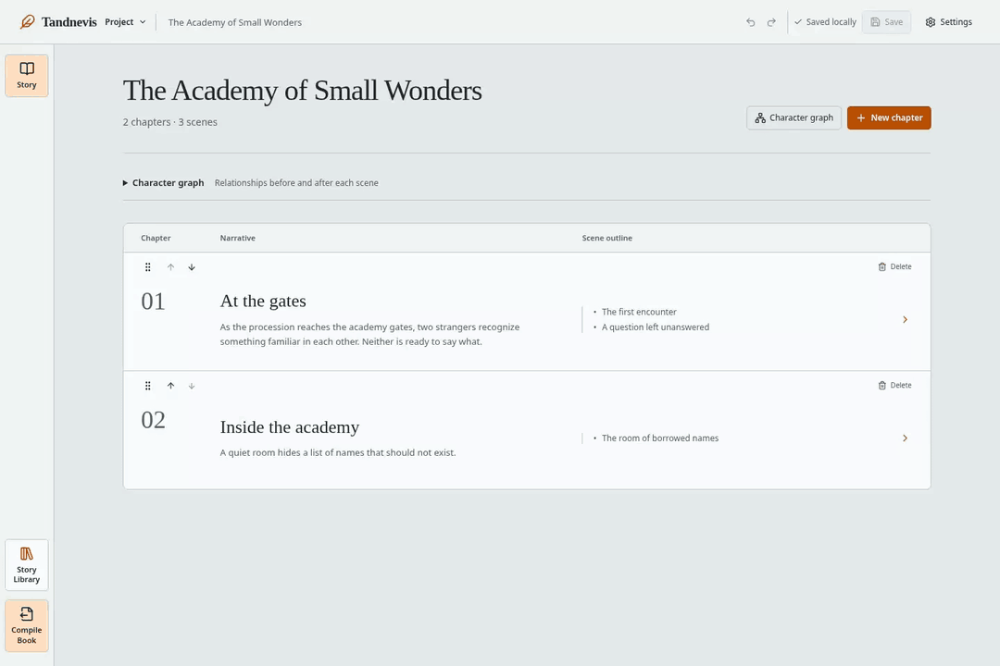

# Tandnevis

Tandnevis is a local desktop writing studio for shaping a story with chapters, scenes, and ordered beats, then writing editable prose for each scene. You can write and manage projects offline; ChatGPT generation is optional. Existing Windows packages and project files retain their Shorthand Writer names for compatibility.

*Browse character starting points and 58 stock types, set optional guidance, and review the profile.*

## Start on Windows

Download the portable Windows ZIP from [GitHub Releases](https://github.com/riasat-mahbub/tandnevis/releases), extract it to a folder you can write to, and run `Shorthand Writer.exe`. The app requires Microsoft's Edge WebView2 Runtime. If it is missing, install the Evergreen Runtime from Microsoft's [WebView2 download page](https://developer.microsoft.com/en-us/microsoft-edge/webview2).

Choose **New project** or **Open project** from the welcome screen or the **Project** menu. Projects are local `.shorthand` files saved where you choose. No account is needed to create or edit a project.

## Shape and write a story

1. In **Story**, browse numbered chapter rows with narrative excerpts and a scene outline. Open a chapter to add and arrange scenes in its connected list, then open a scene to write. **Compact scene list** provides a denser view of that chapter.
2. Write the scene's direction in **Scene summary**. Use **Add beat** to create ordered beat cards beneath it, and write narration or dialogue in **Scene prose**.
3. Open **Story Library** from the left utility rail (the bottom bar in narrow windows) to search **Characters**, **Emotions**, and **Tones** together in a drawer. Choose a definition or category to access its full editor, archive filters, and usage list. Escape returns to your writing; **Story** in the rail returns to the story overview. In a scene, **Writing tools** shows all three groups with one shared search and **Show all** controls. Click a block to insert at the last active caret, or drag it into the summary or a beat.
4. To make a character, choose **New character**. The four steps are **Starting point**, **Name and icon**, optional **Profile details**, and **Review**. Start blank or adapt one of 58 stock character types, including five ensemble functions. Tone and emotion defaults are optional; **None** leaves either unset. Review the profile and choose **Create character**, then **Save** to write the project changes to disk.

Reorder scenes and beats with drag and drop or the move controls. Use the **Undo** and **Redo** buttons for recent project changes. Deleted scenes, beats, chapters, and unused definitions go to **Trash**, where you can restore them.

Navigate through **Story → Chapter → Scene** by opening chapters and scenes. Zooming out from a scene returns to its chapter; zooming out from a chapter returns to Story. Each canvas restores its own scroll position. Click the current scene name to search the temporary outline; **Previous** and **Next** follow narrative order across chapters. The library drawer returns to the writing canvas it was opened from. Collapse the writing-tools shelf for more writing space; optional **Scene details** live at the bottom of that shelf. Navigation preserves opened editors, pending writing, caret position, and local text undo within the project session.

## Character relationships

Choose **Character graph** beside the story title on the Story canvas to open the relationship map. Each Scene also has a **Character graph** button beside its title. The button opens the graph, scrolls it into view, and focuses its heading. Establish initial story relationships or choose a scene and inspect **Before / After**. Add directed attitudes or family ties, or explicitly shared relationships. Selecting character boxes focuses the graph on one or several people; the list shows full descriptions. Zoom, pan, Fit, movable labels, and **Save SVG** support larger maps.

Before inherits earlier scenes in chapter/scene order. Editing Before records an entry correction at that scene; editing After records its outcome. Unchanged relationships carry forward. **Clear at this point** clears a relationship from that point onward; **Use inherited state** removes a local override. After edits start as **Planned**; **Mark established** records that the result has been reviewed. These edits support project Undo/Redo and require Save in manual mode.

AI beat and prose generation receive the relevant characters’ entering relationships and intended After changes automatically. Linked character blocks and characters whose relationships are edited in this scene are included; **Additional characters for AI context** adds relevant offstage people. **Preview scene context** shows the briefing. Later changes stay out of earlier scenes; prose acceptance does not establish planned relationships. Inheritance follows story reading order, so flashbacks need explicit Before corrections and a correction when returning to the later timeline. Relationship history is stored in the `.shorthand` project; outline Markdown and compiled manuscript exports do not include it.

## Save and move between projects

Saving is manual by default: choose **Save** or press **Ctrl+S**. To save automatically, turn on **Autosave** in **Settings**. If you close or switch projects with unsaved changes, choose whether to save, discard, or cancel.

The **Project** menu also has **Import Markdown...** and **Export outline as Markdown...**. Import adds Markdown as chapters, scenes, and beats; export includes the story outline and beat text. These are explicit import and export actions, not a live sync.

## Compile a manuscript

Choose **Compile Book** in the utility rail, or press **Ctrl/Cmd+Shift+E**, to export written scene prose as **Markdown**, **plain text**, or a standalone **HTML** document. Compilation starts with the current story, chapter, or scene. You can change that scope, include a title page or contents, show scene titles, choose scene breaks, and decide whether unfinished scenes should be skipped, included as placeholders, or block export.

The preview and file use the same snapshot of your writing, including queued prose edits. Compilation does not require project Save. If the writing changes while the preview is open, choose **Refresh preview** before exporting. Chapter and scene order follow the manuscript. Summaries, beats, library definitions, and unaccepted AI drafts are excluded. Closing compilation returns to your writing without replacing the editors.

Choose **Export** to select a destination in the desktop Save dialog. Canceling leaves your project untouched; a failed export keeps the preview open so you can retry. The browser preview can show compilation, but file export requires the desktop app. Native PDF export is not included in this version; the HTML document can be opened and printed separately in a browser.

## Optional ChatGPT generation

To generate in a scene, connect ChatGPT and verify a model in **Settings**. Generation needs an internet connection and eligible ChatGPT plan access; availability depends on your account and the current app build. **Generate beats** proposes beats from the summary. **Generate prose** drafts from the summary and beats. Compare each proposal beside your editable source; narrower windows stack the proposal below it. Accepting beats appends them, while accepting prose replaces the existing scene prose. **Close review** keeps the draft available through **Review draft**. You can continue writing without connecting ChatGPT.

## Projects and backups

In portable mode, app settings and recovery data are stored in a `data` folder beside the application. Each `.shorthand` project is saved separately at its chosen location. Back up your project files separately from the portable app folder.
