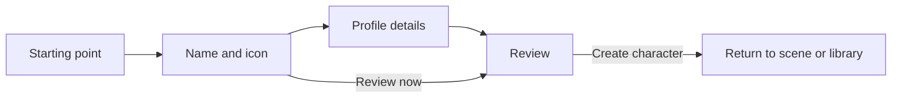

# Character creation wizard

Planned 21 November 2026. This is a proposal; the application still uses the single-page creator. It supersedes the creation-page composition in [the stock-character revamp](stock-character-revamp-plan.md) when implemented. The 53 stock types, research notes, icon registry, and saved character model remain the foundations.

## Problem and intended outcome

The current creator puts naming, an icon picker, category filtering, search results, a type preview, source information, three profile fields, replacement controls, and creation actions on one page. The project character list adds a second navigation task alongside that work. A writer must work out which controls are choices, which alter the draft, and which finish creation.

Replace that composition with a focused, full-page wizard inside the existing application shell. Show one phase at a time and one primary forward action. Retain the Platinum/Harvest Orange palette, sage character identity, typography, and light/dark appearances. This is a task-oriented flow, with no new visual identity or third writing view.

Success means a writer can choose a starting point, make it their own, and create exactly one reusable character without losing their place in the scene. Only the name is required. Ordinary editing of an existing character remains direct library editing.

## Recommended sequence

Four named steps: **Starting point → Name and icon → Profile details → Review**.

### 1. Starting point

Initially show two clear choices: **Start blank** and **Choose a stock type**. Do not show the catalog until requested.

- Start blank advances to Name and icon with empty profile fields and the default person icon.
- Choose a stock type opens a dedicated browsing view within this step. It replaces the two-choice view rather than appearing underneath it. Provide a clear return to those choices.
- Give browsing the available page width: search and category buttons above results and a preview. Remove the project character list. At narrow widths, use results followed by a selected-type detail view with a clear return to results; avoid two independent narrow scroll panes.
- Preview shows the name, icon, a short description, and any essential historical/context note. Full suggested background/personality/voice and source details sit behind **Suggested profile** and **About this type** disclosures. Bibliographic text and copyable links remain available offline.
- Selecting or previewing a result does not change the active draft. **Use this type and continue** explicitly copies its suggested fields and advances. This is the only primary forward action in the browsing view; remove the old in-preview Use template plus separate Next combination.
- Keep search, category, selected result, and scroll position when returning from a later step. Search continues to support aliases, historical connections, tags, and accent-insensitive matching. No-results recovery keeps Start blank available.

### 2. Name and icon

Show a prominent character-name field and a compact icon preview with **Choose icon**. The 32-icon grid opens only on request. A stock type supplies an initial icon; a blank character starts with the person icon. Either can be customized or reset.

Show the chosen starting point as a short, quiet line with **Change starting point**. Keep source explanations and catalog controls in step 1.

**Next: Profile details** requires a valid name under the existing rules. Show validation next to the name, focus it when necessary, and preserve current duplicate-name behavior. Provide a secondary **Review now** shortcut once the name is valid. It skips optional profile editing and retains any supplied template text.

### 3. Profile details

Show only Background, Personality, and Baseline voice, with short plain-language prompts. These three fields share one purpose and can fit comfortably once the catalog, sources, and icon grid are elsewhere. Keep them in a single reading column and make all three optional.

For a stock type, prefill the copied suggestions and explain once that they are editable starting text. For a blank character, use empty fields with useful prompts. Do not add mandatory biographies, personality questionnaires, generated suggestions, or an additional AI connection flow.

Use normal field sizes and allow page scrolling for longer writing. Keep the navigation footer reachable. **Next: Review** works with all three fields blank. Avoid separate Clear all and template replacement controls on this step; ordinary editing and the controlled starting-point change cover those needs.

### 4. Review

Show the name and icon prominently, followed by readable Background, Personality, and Baseline voice sections. Empty fields say **Not added**. Each section has a clearly named Edit action that returns to its owning step without losing other values; returning from that edit goes back to Review.

The final action is **Create character**. Explain briefly that this adds the character to the project and that project Save still controls writing to disk. Before this action, no project character exists.

After success:

- From a scene: return to that scene and its existing editor position, with the new character available in the Characters shelf. Do not insert a reference automatically.
- From the Characters library: open the newly created profile in its ordinary editor.

Keep the workflow's original destination even when editing earlier wizard steps. Do not reset the wizard or drop the writer into another creation flow automatically.

## Navigation, layout, and draft safety

- Use a compact, labeled four-step indicator with the current step identified accessibly. Completed steps can be revisited; future steps are unavailable until their prerequisites are satisfied. Use meaningful step names rather than an unexplained progress percentage.
- Show one step title, a short instruction, and that step's content. Hide the project character list and the redundant New character action during creation. Naming, profile editing, and review use a comfortable reading width; stock browsing can use a wider layout.
- Put **Back** on the left and the one primary forward action on the right of a consistent footer. Keep **Cancel creation** quieter and clearly separate from step navigation. On small windows, the footer must not cover fields, focus outlines, validation messages, or the last line of review content.
- Back, ordinary app navigation, search, and category changes preserve the draft. Reopening New character resumes its current step and values. Returning to the library can show a small **Resume character draft** action so its location is clear.
- Explicit Cancel discards the wizard draft and returns to the original destination. Browsing alone can be canceled immediately. If the writer has entered a name, custom icon, or personal profile text, show a compact discard confirmation with **Keep working** and **Discard draft**.
- Drafts belong to the current project session and do not become saved project records. Handle project switching/closing through an explicit draft-discard decision, without marking the project dirty merely for browsing. Crash recovery for unsubmitted wizard drafts is a separate future feature; do not imply that project Save saves them.
- Changing a starting point keeps the typed name and any icon explicitly chosen by the writer. An untouched suggested icon may follow the new type. If the change would replace nonempty profile fields, show a confirmation explaining exactly which fields change; declining restores the prior applied starting point and leaves every draft field intact. Template previews remain provisional until the forward action is confirmed.
- Keyboard focus moves to the new step heading or its primary input. Back restores a useful focus position. Enter in catalog search never creates a character; only the Review step can submit. Step changes need no decorative animation and respect reduced motion.

## Creation and recovery behavior

The final step dispatches the existing single character-creation operation with the current name, icon, background, personality, and voice. Step visits, previews, and edits do not dispatch project writes. No new saved-character schema or template provenance field is required.

While creating, show **Creating…** and prevent a second submission or starting-point change. On a definite failure, keep the complete draft on Review and offer recovery using the existing workspace mechanism. If a response is lost or a retry discovers a committed creation, resolve to that record rather than creating another. Preserve the established external-change conflict handling; do not blindly replay an ambiguous creation. Once created, ordinary Undo/Redo and manual Save apply.

## Implementation sequence

1. **Isolate the flow state.** Introduce a project-scoped wizard draft/controller with current step, original destination, draft values, applied/provisional starting point, writer-edited icon state, visited steps, review edit-return state, and submission/recovery state. Keep this independent of the saved Character model and of preset creation.
2. **Build the focused wizard shell.** Separate creation from the LibraryView master/detail layout. Both existing New character entry points open the same flow. Retain ordinary existing-character editing and preset libraries.
3. **Reuse and simplify controls.** Adapt the stock browser into step 1 and reuse the icon registry/picker in step 2. Give profile fields their own step and add a readable Review screen. Remove creation-only controls from the old combined page.
4. **Connect navigation and recovery.** Implement resume, Back, review Edit links, safe starting-point changes, cancellation, project-boundary handling, original-destination return, and single-operation submission. Reuse the current recovery safeguards.
5. **Verify the actual flow.** Update component/App/native smoke checks, then inspect all four steps at 1440px and 800px in both themes. Include the narrower stacked browsing state. Review once, batch fixes, and confirm once. Update workflow docs and release evidence only after the wizard exists.

## Acceptance checks

- Blank route: Start blank → Name and icon → Review now → Create produces one character with the chosen icon and empty optional fields.
- Stock route: preview without mutation → apply → name/icon → edit optional fields → review → create uses exactly the reviewed values.
- Each step displays only its phase's controls. The full catalog, icon grid, editing fields, and source bibliography never appear together.
- Back, review Edit, app navigation, and resume preserve values and the correct return location. Applying a different type cannot silently overwrite edited profile fields or a chosen icon.
- Cancel has no project-write side effects. Unsubmitted drafts cannot leak into another project's wizard.
- Name validation is local and understandable. Search Enter cannot submit. The final action cannot create duplicates while pending or after recovery.
- Creation failure retains Review and all field values; successful recovery resolves to the existing created record. External-conflict handling remains available.
- Returning to a scene preserves its summary, beats, prose, references, caret/scroll context, and pending edits. No character token is inserted automatically.
- Created icons still persist through Undo/Redo and Save/reopen and remain outside generation context and fingerprints.
- Keyboard operation, visible focus, readable text, both themes, and responsive layouts work without horizontal overflow or hidden navigation actions.

These are proposed interaction decisions for review. No wizard implementation, runtime testing, or release rebuild is part of this planning pass.
