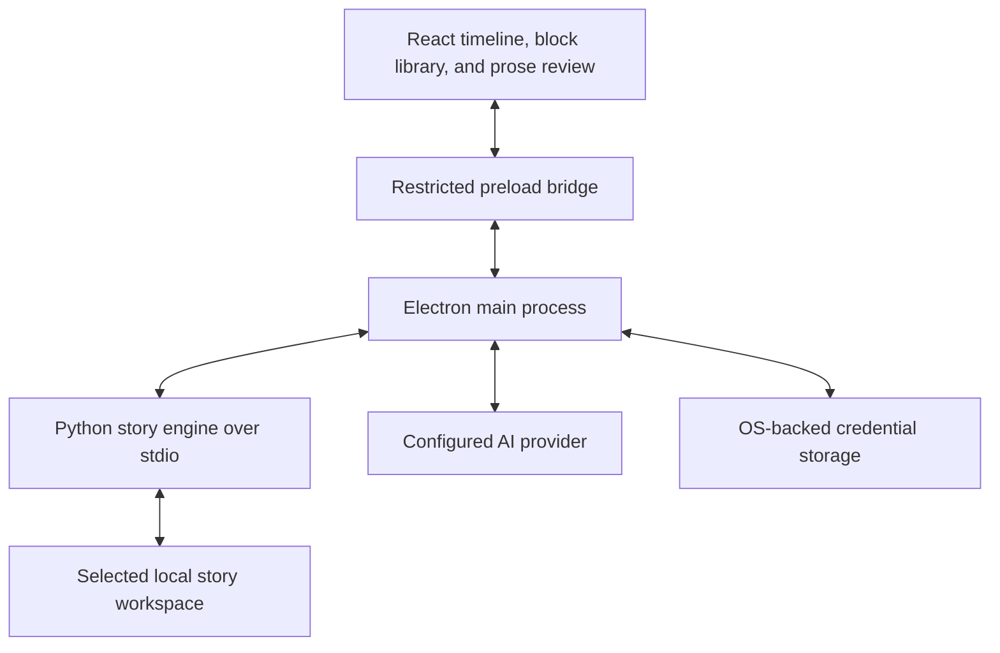

# Shorthand Writer — development plan

Status: proposal, 19 November 2026. This plan changes no story canon or source files.

## 1. Product direction

Build a local desktop writing application around the existing scene-shorthand framework. Scenes sit on a vertical story timeline as draggable scene blocks. Selecting a block opens that individual scene in the scene writer. Each scene has a main idea/summary box and an ordered set of beat cards; each beat is a freeform text editor that can mix ordinary writing with reusable draggable blocks. A beat can contain zero, one, or any number of characters. AI develops that direction into a lived scene. The writer can edit prose directly, compare alternatives, and decide which draft becomes the current source.

**Confirmed requirements:** separate application repository; an Electron-like local app; a vertical timeline of draggable scene blocks; individual scene editing in the scene writer; the main scene idea/summary in a box; ordered beat cards with freeform text and no required cast size or actor/recipient fields; separate reusable character, emotion, tone, and voice/delivery blocks; optional stage references and a possible physical stage board; human-authored shorthand and tags; AI primarily for prose generation.

**Confirmed navigation:** use separate Story and Scene views as two conceptual zoom levels. Story shows the whole-story vertical timeline; opening a scene switches into its writer. Preserve the accepted scene-writer workflow and hierarchy, with a clear return to the overview.

**Next interface iteration:** add a playful touch through selective skew and asymmetry, plus discoverable create/edit/duplicate/delete controls. Keep writing surfaces comfortable and make removal recoverable. The concrete scope, control inventory, state rules, and acceptance checks are in [the playful interface and editing plan](interface-plan.md). These additions are planned; the current prototype remains the functional baseline.

**Proposed first-release scope:** Windows first, one writer, one open story workspace, Markdown-backed authoring, and one directly integrated AI provider. Provider choice remains open. Local authoring and review work offline; cloud generation requires a connection. Supporting local models can be a later provider adapter.

The primary workflow is:

1. Select or create a scene in the outline.
2. Write the scene summary, then develop it in freeform beat cards, adding character, emotion, tone, or voice blocks where helpful. Attach a stage only when wanted.
3. Inspect the characters' accumulated state at this point when needed; this is not a required form-filling step before writing.
4. Record any intended outcomes separately from established changes; neither outcomes nor character metadata are required for every beat.
5. Generate a prose candidate from the approved project context and current direction.
6. Compare, edit, or regenerate the candidate.
7. Accept the prose and review which meaningful changes it actually establishes.
8. Refresh the packet's evidence, then rebuild the relevant continuity views.

Success means completing this loop without manually editing pipe-separated shorthand or assembling character context across many files.

## 2. Existing framework to preserve

The current project has 59 Part 0 packets, 141 Year One packets, and three independent earlier samples. Reading manifests determine order; filename sorting does not.

| Existing source | Application responsibility |
|---|---|
| `scenarios/parts/*.json` | Outline order, scene identity, source locations, and chapter groupings |
| `objective.md` | Purpose and limits of a scene |
| `scene.md` | Cast, beats, tone, relationships, voices, knowledge limits, and character diffs |
| `stage.md` | Physical anchors, evidence excerpts, open staging, and continuity reviews |
| Starting characters, voices, entry relationships | Beginning state for the selected period |
| Period-specific canon profiles | Established facts and character reference |
| Existing prose files | Current authored manuscript sources |
| `context/` | Derived inspection and prompt outputs |

The framework already distinguishes directed relationships, local delivery, persistent voice changes, individual knowledge, and temporary versus continuing mood. Preserve these distinctions in controls, prompts, and replay.

Additional knowledge/expertise/mood diffs currently cover the first eighteen Year One scenes and two later pilots. Intervening relationship and voice updates are replayed, but this is a sparse knowledge model. A missing entry means **unmodelled**, not necessarily ignorant. Full equivalent simulation coverage for Part 0 is a later extension; opening its packets should still work.

Canon, provisional staging, editorial interpretation, and unresolved questions remain distinct. Cooperation does not automatically mean friendship; physical presence does not mean someone heard or understood a remark. A successful build does not certify literary quality.

## 3. Two views at two zoom levels: story overview and scene writer

Use two distinct views, at two conceptual zoom levels. **Story view** is the whole-story overview with a vertical timeline of draggable scene blocks. Opening a block switches to **Scene view**, the dedicated scene writer for that scene. Back to story returns to the overview; Story/Scene controls switch between the two levels. The timeline does not occupy a permanent sidebar in Scene view. A chapter/scene breadcrumb preserves orientation. Preserve the accepted scene summary, reorderable freeform beat cards, and library/inspector arrangement while adding the playful visual treatment described below. Structured details support the editor rather than replacing it.

### Two useful scales

- **Story scale:** a vertical timeline of draggable scene blocks grouped by chapter/part, read from top to bottom. Each block shows its title, summary excerpt, and a compact review indicator when relevant. Select a block to edit that scene; drag a block up or down to reorder scenes, with a clear insertion marker. Provide keyboard movement and visible move actions as equivalents. New scenes can begin with only an idea.
- **Scene scale:** switch into the selected scene's writer, with its title, main idea/summary box, scene tone, and ordered beat cards. Each card contains freeform text with optional inline character, emotion, tone, and voice/delivery blocks. A beat can describe atmosphere without characters, one character's thoughts, a conversation among several characters, or a longer passage with several actions. There is no one-character-per-beat or one-utterance-per-beat rule. Use a simple sequence initially; permit an explicit overlap group when the direction needs simultaneous contributions. A graph or automatic time simulation is unnecessary for the first release.

The timeline initially represents **reading order**. Period labels can appear on it, but proportional spacing must not imply exact elapsed time. Chronological grouping or lanes are a later view over explicit time data; unknown dates and overlapping viewpoints remain visible.

### Workspace areas

| Area | Primary content and actions |
|---|---|
| Story view (zoomed out) | Vertical timeline of draggable scene blocks, chapter groups, summary excerpts, and scene creation/reordering actions; opening a scene switches to its writer |
| Scene view (zoomed in) | Individually editable scene title and summary, scene tone, ordered freeform beat cards, and generation/revision actions; Back to story returns to the overview |
| Scene library and contextual details | Preserve the accepted editor layout: reusable blocks in the library, freeform writing in the center, and local scope/character details in the inspector |
| Prose drawer or split view | Generated candidates, comparisons, direct prose edits, and acceptance |
| Optional physical stage | A scene-local board for placing characters, extras, and props over a reusable location layout; writing works without it |

Keep the main idea above the beats while composing. Preserve the selected scene and overview scroll position when moving between views. Collapse the library and inspector for prose review. Support keyboard navigation, visible focus, adjustable text size, and text labels alongside status colours. Every drag action also has an Add action and keyboard movement equivalent.

### Scene selection, editing, and visual direction

- A scene block and its editor refer to one stable scene identity. Editing the title or summary updates the timeline block; switching scenes preserves unfinished title, summary, beat, and prose buffers.
- Moving a scene changes its timeline position and dependent context, while its summary, beats, candidates, and prose remain attached to the same scene. Provide undo for movement and clear feedback about affected continuity views.
- Preserve the accepted scene-writer hierarchy and behavior. Add gentle skew to card backings or tabs and bounded asymmetric offsets to overview scene blocks; keep editable text, controls, focus outlines, and timeline/drop markers aligned and readable.
- Keep the established warm neutral surfaces and restrained character/emotion/tone colors. Selection, focus, hover, and drop targets must be legible in light and dark modes. Avoid permanent forms or repeated metadata around every beat.
- On smaller windows, reflow scene tools around the editor; Story and Scene remain separate views. The overview timeline stays vertical at every size.
- The revised design reference is [the scene writer prototype](../outputs/scene-writer-studio.html). It illustrates the intended interaction and visual hierarchy; it is a local prototype, not the installed application or a connected AI generator.

### Planned playful treatment and complete editing controls

Follow [the interface plan](interface-plan.md) for the next iteration. In the story overview, scene blocks alternate left/right around a numbered central vertical spine, with staggered positions and slightly varied widths. Reading order determines side after reordering; subtle backing angles remain tied to identity. Freeform beat text remains horizontal. Calm appearance removes decorative transforms without changing reading order; reduced motion is respected independently. Narrow layouts use one readable column and a left spine.

Add visible creation actions and labeled contextual menus for chapter/scene/beat editing, insertion, duplication, movement, and recoverable deletion. Expand the reusable library with basic author-created character profiles, preset/template editing, usage inspection, archiving, and deletion of unused entries. Keep imported canon changes on their source-linked review path.

Duplicated scenes/beats receive new identities while keeping references to the same reusable characters/presets. A scene duplicate starts as direction only; it does not inherit accepted prose, evidence assertions, or continuity approval. Used library entries can be archived without breaking existing scenes. Removing a local chip or token never deletes its global definition.

Scene/chapter removal uses project Trash and supports restoration; beat deletion supports Undo and resolves any evidence references. Define Trash persistence, restore ordering, reference handling, and undo transaction boundaries during the schema spike. Destructive purge, extensive bulk operations, and a general project-management wizard are later work.

### Reusable blocks and ordinary text

| Block | Reuse behaviour | Scene-specific controls |
|---|---|---|
| Main scene idea | One editable main idea box per scene | Purpose, central action/pressure, and what should matter to the reader |
| Character | Reference the same period-specific character across scenes | Participation, actor/recipient role, viewpoint where appropriate, and local direction |
| Emotion | Save a reusable emotion label or guidance preset independently of a character | Attach to a specified character within a beat or selected passage; do not change their baseline voice or persistent state |
| Tone | Save a named tone or tone progression as a reusable preset | Apply to the whole scene or an explicitly selected beat/group |
| Voice | Reuse established baseline guidance or an author-created voice preset | Choose the character and scope; distinguish current delivery from a proposed persistent change |
| Stage (optional) | Reuse a location's established anchors or a provisional stage template | Scene-local conditions and optional opening positions; a written location is sufficient without a board |
| Extra/group | Optionally reuse lightweight role templates such as nurse or students | A scene-local participant or crowd with optional description, action, dialogue, and position; no full profile required |
| Beat | Reorder or reuse a freeform direction passage | Ordinary editable text with optional inline blocks; zero or more characters; no mandatory actor, recipient, or delivery fields |
| Regular text | Write notes and direction without converting each sentence to a block | Mark as generation direction or author-only comment; default to generation direction |

Drop targets communicate meaning. Dropping a character into a beat inserts a shared character reference at that point in the freeform text; a beat can contain any number of references. Dropping a character on a scene header adds them to the cast, and dropping one on an attached physical stage places their scene instance. Structured actor/recipient slots are optional inspector details. Dropping an emotion onto a character reference applies it to that character within the beat or an explicitly selected passage; a multi-character beat must never silently apply the emotion to everyone. Tone and voice blocks display their scope. A stage block dropped on a scene sets its optional stage reference; a beat-level stage note affects that beat. Merely placing two character blocks beside each other never creates a relationship or shared knowledge.

A physical stage, if included in the first release, begins as a simple 2D layout with draggable labeled objects and character tokens. Opening positions are local to the scene. Do not imply automatic movement or visibility/hearing simulation. Defer animation, pathfinding, and spatial simulation. A scene remains fully writable and generatable with no stage or character blocks at all.

Library entries can be created, named, searched, duplicated, and reused by the writer. Begin with characters, baseline voices, and stage references already supported by the project; new templates remain provisional authoring material. A character reference uses the appropriate story period, not a later profile.

To protect earlier scenes, dropping a tone/voice/stage preset inserts an editable scene snapshot with a reference to its source version. Editing that instance affects only the scene. Editing the reusable preset creates a new library version; offer an explicit preview before applying it to existing instances. Character identity remains a shared reference, while its calculated state remains scene-specific. Do not maintain a second relationship database inside the block library.

### Structured details behind the blocks

- Preserve title, period, location, viewpoint, cast, purpose, and optional tags. Existing fields load from their current sources; avoid duplicate copies of manifest metadata.
- Keep narration settings optional and inherit the story's defaults. Grammatical person (first/third person) is separate from whose thoughts the narrator can reveal (limited/omniscient/external). Do not require a character viewpoint selection to create a scene.
- Support `@self`, `@room`, and `?` recipients, named characters, groups, generic roles, and offstage correspondents. Unknown recipients stay unknown.
- Keep scene tone progression, per-beat delivery, and persistent default changes separate. Tone presets are guidance, not global character mutations.
- Separate intended outcomes from recorded relationship, voice, knowledge, expertise, and mood changes. Select the evidence beat where required.
- Preserve continuity check kinds and the existing `check`, `needs-revision`, and `reviewed` statuses.

Tags filter and describe content; they do not establish facts. Beat cards provide visual structure around freeform text: no mandatory beat per utterance, no cast-size constraint, and no requirement to prescribe every movement. The scene summary gives the overall intent; beats develop that intent without replacing it.

### Timeline editing and Markdown compatibility

Move scenes within a chapter first, then support cross-chapter moves with an impact preview. A move updates manifest positions and affected packet metadata together, invalidates dependent views, and preserves scene identity and prose paths.

Reordering beats also remaps character-diff evidence references. Deleting a referenced beat requires reassignment or removal of that reference. Give blocks stable internal identities so a display renumber does not break references.

During the schema spike, specify how mixed text, preset provenance, and optional overlap groups map to the Markdown packet. Existing semantic fields remain authoritative. A small versioned authoring section can hold block identities, ordering references, and provenance; it must not introduce a competing editable copy of the same beat, stage, or relationship. Store reusable presets as readable, versioned project Markdown. Preserve imported packets and unknown content without mandatory migration.

## 4. Make the framework support shorthand-first authoring

The current extraction tooling assumes prose already exists: it requires matching source hashes and rejects an entire part when a packet is stale. An authoring app must also support a new scene with no prose, incomplete direction, and revised prose awaiting packet review.

Introduce these capabilities without weakening the existing strict build checks:

1. Separate document parsing, format validation, source-freshness checks, and replay. The editor can open an incomplete packet and report useful field-level diagnostics; strict export still rejects invalid inputs.
2. Add an explicit lifecycle for new scenes: direction only, candidate available, current prose awaiting review, and packet reviewed against the current source. Imported scenes retain their existing provenance; a matching hash alone does not confer editorial approval.
3. Define a small, versioned Markdown extension for intended outcomes, proposed in `objective.md`. Planned updates may have a preview, but do not feed the established replay. Existing `relationships`, `voices`, and `character-diff` blocks retain their meaning as authored draft assertions.
4. Keep current-source and packet-reviewed fingerprints separate. Accepting a candidate makes its prose current; only a subsequent packet review can refresh the reviewed source hash. Bind review completion to the exact bytes reviewed.
5. Keep draft evidence distinct from canon approval. No lifecycle action promotes a draft assertion to canon.

Proposed new metadata must be documented and tested for compatibility before rollout. Preserve existing packets without rewriting them merely to import them. Unknown Markdown sections survive form editing; unsupported syntax remains accessible in a raw editor.

When an upstream packet is stale or invalid, keep the editor usable and label downstream calculations accordingly. Do not quietly omit the problem scene or present its dependent state as current. A last valid snapshot may be shown with its source revision clearly identified.

## 5. AI prose generation is a core feature

The first usable authoring release includes one integrated generation path. Provider selection and credentials are settings, not part of the story files. Keep the provider interface small enough to add another backend later.

### Context assembly

Build an inspectable generation request from:

- The selected scene's main idea, ordered text/beat flow, scoped tone/voice/stage instances, intended outcomes, and explicit limits. Exclude author-only comments.
- Period-appropriate canon references and the project's prose style guide.
- The selected characters' entering state, directed attitudes, and relevant prior developments, each with provenance and coverage limits.
- Relevant adjacent prose and continuity details, selected deliberately rather than the full manuscript.
- A distinction between author knowledge, viewpoint knowledge, other characters' knowledge, and facts to withhold from the reader.

The existing context builder extracts approved canon capsules; it does not yet assemble this full scene request. Add a separate assembler that reuses those sources and replay logic. Make truncation visible, and never silently drop knowledge or revelation limits to fit a request.

Do not import later scenes or a later-period profile into an earlier scene's entering state. For overlapping viewpoints, preserve established dependencies and flag uncertain chronology rather than inventing an exact timeline.

### Generation and revision

Provide Generate, Stop, Compare, Revise with instruction, and Accept candidate. Stream text without blocking editing. Capture the exact direction/context revision, model settings, and outcome with each candidate. If inputs change while generation runs, retain the result but mark it as based on earlier direction.

Save candidates separately from the manifest-linked prose, proposed under `scenarios/candidates/<scene-id>/`. Candidates are never included in reading editions automatically. Support rejecting a candidate without losing the existing draft, recovering partial output, and comparing alternatives without overwriting them.

Acceptance is a deliberate replacement of the current prose with a recoverable previous version. It does not accept model-suggested character diffs, invent canon, clear continuity concerns, or refresh the packet hash. The writer reviews those consequences separately, with the prose and relevant packet fields side by side.

AI may optionally suggest missing evidence or continuity concerns after drafting; those are suggestions until the writer records them. Preserve creative room: a compressed beat can expand into multiple exchanges, and incidental compatible detail remains provisional staging.

Show which content will be sent to the selected provider and usage/cost information where available. Keep keys outside Git using OS-backed storage, with no plaintext fallback. Electron provides an OS-backed storage facility; its exact platform semantics and supported API must be checked against the release version. [Electron safeStorage documentation](https://www.electronjs.org/docs/latest/api/safe-storage).

## 6. Proposed technical architecture

Use Electron for the desktop shell, React with TypeScript for the web UI, and a Python worker for the existing parsing and replay algorithms. This keeps the web presentation separate from the story engine. React documents TypeScript support for components and UI contracts. [React TypeScript documentation](https://react.dev/learn/typescript).



The Python worker owns story-file reads, writes, validation, and replay. Electron owns native dialogs, application settings, provider requests, and worker lifecycle. The renderer receives typed commands and results through a narrow preload API. Electron documents this separation through its IPC model; keep renderer isolation and sandboxing enabled, validate messages, and render Markdown without executable content. [Electron IPC](https://www.electronjs.org/docs/latest/tutorial/ipc), [Electron security guidance](https://www.electronjs.org/docs/latest/tutorial/security).

Communicate with the worker using versioned request/response messages over standard input/output. No localhost web server is required for the installed app. Include request IDs, cancellation, structured errors, job progress, and worker restart/recovery.

### Keep software and story repositories independent

The application opens a chosen workspace directory; it never assumes the vault is beneath its installation or application repository. Ship the reusable engine with the app, rather than executing arbitrary scripts found in an opened project.

Initially adapt the existing `build_scene_maps.py` and `build_character_pilot.py` logic into a reusable engine package, preserving attribution and behavioural parity. Generalise fixed repository roots, the Year One selection, and draft endpoints through explicit project configuration. Preserve the original vault's command-line workflows during this work.

Proposed application layout:

```text
desktop/                 Electron main process and preload
ui/                      React authoring and review interface
engine/                  Python parsers, serializers, replay, and worker
contracts/               Versioned IPC schemas
tests/fixtures/          Synthetic miniature story projects
docs/                    Product, format, and development documentation
```

Do not copy the private story vault into the application repository. Use the real vault as an external compatibility target, with intentional testing on a disposable copy. Commit synthetic fixtures that exercise the same shapes and edge cases.

### Persistence and recovery

Markdown and existing manifests remain the source of truth. Structured controls edit bounded sections while preserving unrelated text, links, Unicode, and line endings. Untouched files remain byte-identical. Reject unsupported pipe/newline values clearly unless an explicit compatible escaping scheme has been introduced.

Use recoverable write transactions, a single workspace writer, and expected-content hashes to detect external edits. Recheck before saving; offer compare/reload rather than overwriting work from Obsidian. Group multi-file changes in a journal so scene creation, movement, or candidate acceptance can recover after interruption.

Autosave authoring buffers independently of packet review. Store UI preferences and recovery buffers in application data; portable project metadata belongs in a documented Markdown block or a small project configuration file. Optional caches are disposable and contain no authoritative relationships or entering-state records.

Watch external file changes and invalidate affected views. Reject paths outside the selected workspace, including resolved link/junction escapes. Git remains optional: show changed files and readable diffs first; integrated commit/sync can wait.

## 7. Delivery milestones and acceptance gates

These are dependency-ordered milestones, not calendar commitments. Estimate effort after the first engine and packaging spike.

| Milestone | Deliverable | Acceptance gate |
|---|---|---|
| 1. Engine and packaging spike | Independent repository, worker contract, read-only import, and a minimal packaged Electron shell | Opens a disposable vault copy, enumerates all three sequences correctly, reproduces representative replay results, and launches without system Python |
| 2. Two-view authoring, editing controls, and visual treatment | Separate Story/Scene views; vertical timeline; summary and freeform beats; chapter/scene/beat create/edit/duplicate/move/recoverable delete; basic character/preset management; optional stages; playful styling and Calm appearance; safe persistence | Complete the authoring/library/Trash/Undo flows and visual-accessibility gates in the interface plan; preserve independent buffers, stable identities, local/global scope, evidence references, unknown Markdown, and recoverable work |
| 3. AI prose loop | Scene context assembler, one provider, streaming, candidate labels/editing/comparison/recoverable removal, and deliberate acceptance | Generate from structured shorthand, revise, remove an unaccepted candidate without affecting the manuscript, accept prose, and recover the previous source; no automatic canon/state/hash updates occur |
| 4. State and continuity review | Entering/exiting inspector, source-linked histories, intended-outcome handling, packet review, and derived views | Intended knowledge never enters actual replay; stale inputs stay visible; review refreshes evidence only for the prose actually inspected |
| 5. Usable desktop release | New/move scene transactions, search/filter refinement, accessible keyboard flows, installer, and explicit exports | Complete the entire authoring loop on a disposable real project, reopen it successfully in Obsidian, and install on a clean Windows environment |

For milestone 1, select synthetic scenes covering a directed relationship, a local mood, a continuing mood, received testimony, and a stale source. Treat packaging as an early feasibility test rather than postponing it until the UI is complete.

Package the Python worker with its interpreter, then include it with the desktop installer. PyInstaller supports self-contained distributions but requires platform-specific builds and explicit handling of dynamic imports and bundled resources. [PyInstaller operating model](https://pyinstaller.org/en/stable/operating-mode.html). Electron Forge is a proposed installer/build pipeline. [Electron Forge documentation](https://www.electronforge.io/).

## 8. Validation strategy

- **Compatibility:** golden inputs and outputs for existing scene parsing, replay, and strict build behaviour. Round-trip unchanged packets byte-for-byte and preserve unrecognised content during targeted edits.
- **Story semantics:** directed attitudes stay directed; events do not overwrite standing relationships; local moods do not persist; reader revelations do not become character knowledge; periods reset appropriately; uncertain chronology is visible.
- **Authoring lifecycle:** a scene with no prose remains editable; intended updates cannot affect replay; source changes require renewed evidence review; beat moves preserve references; scene moves preserve identity.
- **Timeline and reuse:** scenes appear in a vertical timeline; drag and keyboard scene moves retain scene/summary/beat identities and invalidate affected context; switching scenes preserves independent edits and unfinished buffers; title and summary edits update the matching timeline block; freeform beat text/block order survives save/reopen; beats with no characters, one character, and multiple characters all remain editable and generate successfully; multiple actions or paragraphs need no extra mandatory fields; character-specific emotions never spread to other characters in a beat; optional stages and inherited narration settings never block writing; preset edits do not change past instances without an explicit update; keyboard controls can perform every drag operation; author-only comments stay out of generation requests.
- **Two-view navigation:** the overview and scene writer are distinct screens; opening/returning preserves selected scene, independent editing buffers, and overview scroll position. The overview stays vertical at all widths, and the accepted scene editor retains its summary and freeform beat cards.
- **Editing controls and recovery:** create/edit/duplicate/move/delete/undo/restore chapters, scenes, and beats; duplicates receive fresh identities and no copied continuity approval; used library entries archive without breaking references; deleting a local occurrence never deletes a global profile; evidence-linked beat deletion requires explicit resolution.
- **Playful appearance:** deterministic offsets and decorative skew preserve reading order and interactive bounds; editable text/carets remain aligned; verify Calm appearance, reduced motion, light/dark themes, keyboard flow, high text zoom, narrow windows, and long content using the interface plan's acceptance checks.
- **Durability:** conflicting external edits, interrupted multi-file writes, app crashes, missing source files, and restarting a failed worker preserve recoverable work.
- **AI behaviour:** mock the provider for repeatable streaming, stop, timeout, rate-limit, partial-output, and changed-input tests. Inspect assembled requests for missing constraints and future-state leakage. Use a small real generation evaluation separately; prose quality needs editorial judgement.
- **Desktop:** bounded end-to-end checks for project opening, authoring, generation, review, keyboard operation, and installer startup. Verify packaged operation without developer runtimes.

After engine inputs change in a compatibility workspace, preserve the existing checks: scene maps and `--check`, character pilot in both normal and `--draft-run` modes with their `--check` variants, and `python -m unittest discover -s tests`. Canon changes additionally require the existing context/relationship rebuilds. Planning or prose edits never trigger a reading-edition rebuild implicitly.

Normal saves rebuild lightweight derived views as needed. Exporting a compiled Markdown/PDF reading edition is a separate writer action. Preview the target part and destination, preserve existing artwork, and do not equate successful export with finished prose.

## 9. Deliberate later work

Defer multiplayer collaboration, cloud sync, mobile clients, automatic canon promotion, broad historical knowledge extraction, advanced spatial stage editing/simulation, and large-scale autonomous chapter generation. A simple optional placement board can be prototyped without making it a first-release dependency. A generic project-creation wizard and additional AI/local-model providers can follow proven compatibility with the initial framework.

Basic creation and editing of author-created characters belongs in the first authoring release. Imported canon editing retains source-linked review; full retcon workflows require a reviewed multi-file change set and decision record. Defer permanent purge and extensive bulk editing. Retain the repository's distinction between canon, suggestions, and open questions throughout.

## 10. Open product decisions

1. Which AI provider and authentication method should the first integrated generator support? Do not assume an existing chat subscription supplies application API access.
2. How much revision should the first release support: whole scene plus selected passage, or whole scene only? Proposed default: whole scene first, followed by passage revision that includes surrounding context.
3. Should descriptive tags have a shared vocabulary across scenes? Proposed default: freeform tags with suggestions from the current project; constrained values only where the framework defines semantics.
4. Should this become a general writing product? Proposed default: a reusable app proven against the current framework, with project-specific rules loaded from the workspace rather than hardcoded into the interface.

These are software design questions, not unresolved story canon. The next implementation step is milestone 1, using synthetic fixtures and a disposable compatibility copy of the vault.
